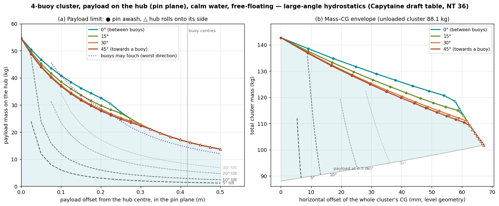
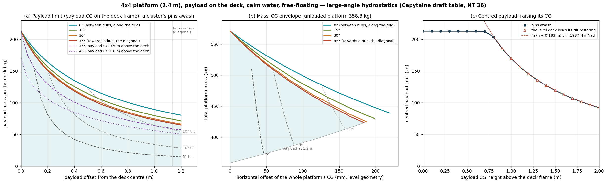
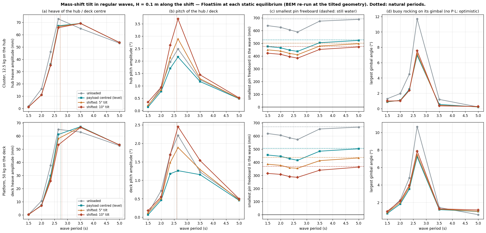

# Payload stability: the 4-buoy cluster (2026-10-14) and the 4x4 platform (2026-10-15)

**Question (Xabier):** add mass on top of the cluster until its stability is compromised, move
that mass around parallel to the waterline, and give an envelope of mass and CG. Then the same
exercise for the platform: see [The platform](#the-platform-2026-10-15) below.

## Decisions

| Item | Choice |
|---|---|
| Mass position | A point mass on the hub, in the pin plane (+0.717 m), moved horizontally |
| Condition | Free-floating, calm water |
| Stability criterion | Loss of restoring, **and the pins must stay dry** |
| Hub tilt | Free on the gimbals: no mechanical stop |
| Method | Capytaine hydrostatics for each draft, plus large-angle statics outside FloatSim (an approved exception). FloatSim cross-checks the small-angle range. |

### Why not FloatSim alone

FloatSim cannot reach the stability limit on its own:
- **Its restoring is a constant matrix at the BEM draft.** Level 2 is not wired:
  `docs/phase2-followups.md` LEVEL2-INTEGRATOR-UNWIRED. Each kilogram on the hub sinks the cluster
  12.6 mm, and the buoy's tilt stiffness triples before the spar tops go under.
- **Its validity ends at 0.1 rad.** An off-centre mass tilts the hub past that long before any
  limit.
- **The hub's weight never loads the joints.** FloatSim's linear model has no weight term.

## Method

1. **`draft_hydrostatics.py`.** Capytaine hydrostatics of the flume BEM hull, re-meshed sunk by
   s = −0.95 … +0.715 m. It uses 36 panels round; the 12-panel mesh reads C55 4.5 % low. At each
   s it gives:
   - the displaced volume;
   - the pin load holding that sinkage, dW = ρg(V(s) − V(0));
   - C33 and C55 about the buoy's CoG.

   The 96-panel mesh at the design draft gives C55 = 74.08 N·m/rad, the record value
   (flume-mooring DESIGN-BASIS §C8). Output: `buoy_hydrostatics_vs_draft.json`.
2. **`cluster_statics.py`: the hinged cluster, exact at any hub tilt.**
   - Every load is vertical, so each buoy hangs vertically from its gimbal. Its pin load is
     dW(s_i), where s_i is the depth of its pin below the design pin plane.
   - The hub (2 kg plus the payload at offset e) is in equilibrium where the potential energy is
     stationary, U(z, roll, pitch) = Σ∫dW + g m_hub z + g m z_payload.
   - The hub is stable while the Hessian of U is positive definite.
   - Each buoy is stable on its gimbal while C55(s_i) − P_i·1.624 m > 0, where 1.624 m is the
     height from the buoy's CoG to the pin.
   - The payload mass is raised from 0 along the equilibrium branch until a pin goes awash, the
     restoring is lost, or the hub rolls onto its side (beyond 85°, the model's range).
   - Grid: offsets 0–0.5 m in 0.025 m steps, in 4 directions (0° = between two buoys, 45° =
     towards a buoy). The square's symmetry covers every direction.
   - Output: `cluster_envelope.json`.
3. **`floatsim_crosscheck.py`.** FloatSim's own cluster model (`mooring_verify.article_cluster`,
   12-panel BEM, gimbal joints), solved statically with its linear constrained system, against the
   statics on the same 12-panel table. At small tilt they agree exactly:
   - sinkage 52.65 / 157.94 mm for 2 / 10 kg;
   - tilt 0.869° and 3.475° vs 3.477° for 1 kg at 0.1 m and 2 kg at 0.2 m, in every direction.
4. **`envelope_plot.py`** draws `cluster_envelope.png`.

## Results



- **A centred mass never makes the cluster unstable; it only sinks it.**
  - The limit is **54.7 kg on the hub**, when all four spar tops (the pins) reach the waterline.
  - The hub's own 2 kg already sinks the cluster 25 mm.
  - The buoys' tilt stiffness on their gimbals rises with draft almost as fast as the pin load
    erodes it. Its margin never falls below 24 N·m/rad, so **no buoy ever flops over** on its
    gimbal.
- **An off-centre mass tilts the hub like a seesaw.** The buoys stay upright; only their
  differential sinkage resists the tilt, 67 N·m/rad. The tilt depends almost only on mass × offset,
  in any direction:

  | Hub tilt | 2° | 5° | 10° | 20° | 30° |
  |---|---|---|---|---|---|
  | mass × offset | 0.24 kg·m | 0.60 kg·m | 1.19 kg·m | 2.35 kg·m | 3.44 kg·m |
  | e.g. at 0.1 m | 2.4 kg | 6.0 kg | 11.9 kg | 23.5 kg | 34.4 kg |
  | e.g. at 0.3 m | 0.8 kg | 2.0 kg | 4.0 kg | 7.8 kg | 11.5 kg |

- **Limits** (payload mass on the hub; tilt and whole-cluster CG offset at the limit):

  | Offset | Between buoys (0°) | Towards a buoy (45°, worst) | Buoys may touch (45°) |
  |---|---|---|---|
  | 0 | 54.7 kg, pins awash | 54.7 kg | — |
  | 0.1 m | 40.9 kg (36° tilt, CG 32 mm) | 36.9 kg (33°, CG 30 mm) | 40.8 kg |
  | 0.2 m | 32.6 kg (71°, CG 54 mm) | 27.8 kg (54°, CG 48 mm) | 28.8 kg |
  | 0.3 m | 22.8 kg, hub on its side | 22.3 kg, pin awash (79°, CG 61 mm) | 21.5 kg |
  | 0.4 m | 17.1 kg, hub on its side | 17.1 kg, hub on its side | 16.1 kg |
  | 0.5 m | 13.7 kg, hub on its side | 13.7 kg, hub on its side | 12.9 kg |

  - Up to about 0.3 m of offset, the first pin going awash sets the limit.
  - Beyond about 0.3 m, the hub rolls onto its side (≥ 85°) before any pin goes under. That
    happens at mass × offset ≈ 6.8 kg·m in every direction.
  - Past about 0.2 m, the buoys may touch each other before either limit.
- **The limits all sit at very large hub tilts** (30–85°). With a free gimbal, the hub tilt, not
  buoyancy, is what an operator will notice first. A practical allowable is better taken from the
  tilt lines, e.g. ≤ 10° hub tilt ↔ mass × offset ≤ 1.2 kg·m.

## Presentation

`Cluster_payload_stability.pptx` (15 slides, `make_payload_ppt.py`) explains the physics with
pictures:
- the cluster and its loads, drawn to scale (`sketch_cluster.png`). Every picture is drawn from
  one fixed direction, 22.5° off the buoy diagonals: seen square-on or along a diagonal, buoys
  hide behind each other, but from 22.5° all four show. A top-view inset gives the payload's
  position;
- three loadings as still strips and animations, from the solved equilibria
  (`payload_figures.py`): the centred mass sinking (`seq_centred.png`, `anim_centred.gif`), the
  seesaw (`seq_offset.png`, `anim_offset.gif`) and the hub rolling onto its side
  (`seq_rollover.png`, `anim_rollover.gif`). The GIFs play in PowerPoint's slide show;
- native, editable charts of a buoy's pin load and gimbal margin against sinkage, the
  tilt-against-moment collapse (`tilt_paths.json`) and both envelopes;
- the cross-checks, guidance and limits.

A copy is in `studies/` (PRESENTATIONS.md). The slide helpers are shared with the platform deck in
`deck_kit.py`.

## Limits of this analysis

- **Static, calm water.** Waves, dynamics and the mooring (its 1° pretension lean) are not
  included and would reduce the margins.
- **The payload sits in the pin plane.** A raised payload adds m·g·h of destabilising moment to
  the hub tilt and needs a new run.
- **The hub tilts freely.**
  - Gimbal travel, payload retention and hub buoyancy are not modelled.
  - Buoy contact is only flagged: axes closer than a plate diameter, 0.287 m.
- **Hull geometry.** The BEM hull lacks the real buoy's stem volume (about 1 L, below the
  waterline). It doesn't change with draft, so dW(s) is unaffected.

## Reproduce

```
python draft_hydrostatics.py   # Capytaine, ~10 min
python cluster_statics.py      # ~10 min
python floatsim_crosscheck.py  # needs flume-mooring/cluster_osu_open_rot45_psd.nc
python envelope_plot.py
python payload_figures.py     # pictures and animations, ~10 min
python make_payload_ppt.py    # the deck
```

## The platform (2026-10-15)

**Question (Xabier):** "the same exercise as for the cluster" for the 4x4 platform.

### Model

- **The platform is the record's** (`articulated_wall.deck` with PLAT_SQUARE_M 2.4 and
  PLAT_ROT_DEG 45, the model `mooring_verify.article_platform` runs):
  - 16 buoys on a 0.8 m grid (outer buoy-centre span 2.4 m), in four 2 × 2 clusters;
  - each buoy hangs from its hub (2 kg) by a gimbal at its pin (+0.717 m);
  - each hub hangs from the deck frame (6 kg, +0.90 m) by a gimbal at the hub centre, in the
    pin plane.
- **Decisions carried over from the cluster:** free-floating, calm water, every gimbal free,
  pins dry; the limit is the loss of restoring or the first pin awash.
- **Payload:** a point mass on the deck frame (+0.90 m, 0.183 m above the pins), moved out to the
  outer buoy-centre line (1.2 m), in 4 directions (0° = between hubs, along the grid; 45° =
  towards a hub, on the diagonal). The deck sits above the pins, so the payload's CG height
  matters. It is run as a sensitivity: full envelopes with the CG 0.5 and 1.0 m above the deck,
  and the centred limit for CG heights 0–2 m.
- **Each hub hangs level, exactly.** The deck's load reaches a hub at its gimbal: the hub centre,
  in the plane of its four pins. That load has no lever arm to tilt the hub, so its four buoys
  sink together and each cluster acts as one vertical spring under the deck (4 × 194 N/m,
  1.131 m from the centre). Only the deck tilts. Equilibrium is solved on the deck's heave, roll
  and pitch. The stability check uses all 11 coordinates, the hub tilts included, and the hub
  moment residual stays ≤ 2e-14 N·m.

Scripts:
- `platform_statics.py`: the platform, exact at any deck tilt, on the cluster's draft table and
  building blocks (`cluster_statics.Buoy`, `rot`, `awash`). It writes:
  - `platform_envelope_h0p0.json`, `_h0p5.json` and `_h1p0.json` (one per payload CG height);
  - `platform_vs_height.json`.
- `platform_crosscheck.py`: FloatSim's own platform model, solved statically.
- `platform_envelope_plot.py`: draws `platform_envelope.png`.

### Results



- **A centred mass on the deck only sinks the platform.**
  - The limit is **212.7 kg** on the deck, when all 16 pins reach the waterline.
  - That is about four times the cluster's limit, less the deck: 4 × 54.7 − 6.
  - Each kilogram sinks the platform 3.16 mm. The deck and hubs alone sink it 44 mm.
- **Off-centre, the whole deck tilts, and much more stiffly than the cluster's hub.**
  - The hubs stay level; the clusters' differential sinkage resists the tilt at **1987 N·m/rad**,
    29 times the cluster's hub (16 buoys at about 0.8 m, against 4 at 0.3 m).
  - The tilt again depends mostly on mass × offset, the same in every direction. The values below
    are the smallest over the offsets: heavy masses at small offsets tilt a little more, because
    they sit above the pins.

    | Deck tilt | 1° | 2° | 5° | 10° | 20° |
    |---|---|---|---|---|---|
    | mass × offset | 3.3 kg·m | 6.2 kg·m | 15.1 kg·m | 30.1 kg·m | 60.8 kg·m |

- **Limits** (payload mass on the deck; deck tilt and whole-platform CG offset at the limit):

  | Offset | Between hubs (0°), CG on the deck | Towards a hub (45°, worst), CG on the deck | 45°, CG 1.0 m above the deck |
  |---|---|---|---|
  | 0 | 212.7 kg, pins awash | 212.7 kg | 170.4 kg, the level deck tips over |
  | 0.2 m | 164.3 kg (11°, CG 63 mm) | 150.8 kg (10°, CG 59 mm) | 105.6 kg (17°) |
  | 0.4 m | 134.9 kg (18°, CG 109 mm) | 118.3 kg (15°, CG 99 mm) | 84.5 kg (21°) |
  | 0.6 m | 114.9 kg (23°, CG 146 mm) | 97.4 kg (19°, CG 128 mm) | 71.7 kg (23°) |
  | 0.8 m | 100.5 kg (26°, CG 175 mm) | 83.6 kg (21°, CG 151 mm) | 62.7 kg (24°) |
  | 1.0 m | 89.2 kg (29°, CG 199 mm) | 72.9 kg (23°, CG 169 mm) | 56.0 kg (25°) |
  | 1.2 m | 80.3 kg (31°, CG 220 mm) | 64.9 kg (24°, CG 184 mm) | 50.7 kg (26°) |

  - With the payload on the deck, every limit is one cluster's four pins going awash together.
    The deck never tips over.
  - Towards a hub is the worst direction, by up to 19 %.
  - The limits sit at 10–31° of deck tilt (up to 37° with a raised CG). As for the cluster, a
    practical allowable is better taken from the tilt lines.
- **A raised payload can tip the deck over: the platform's new limit.**
  - As the deck tilts, a mass at a height H above the pins moves sideways by H × the angle. That
    gives a tipping moment m g H per radian against the clusters' 1987 N·m/rad.
  - The level deck loses its restoring at m (h + 0.183 m) = 1987/g − 6 × 0.183 = **201.6 kg·m**,
    where h is the CG height above the deck. The full calculation follows this rule exactly
    (panel c).
  - Centred, the pins limit the payload while its CG is below about 0.77 m above the deck. Above
    that, the deck tips first: 170 kg with the CG 1 m up; at most 1.83 / 1.16 / 0.82 m for
    100 / 150 / 200 kg.
  - Off-centre, a raised CG lowers the limits (purple lines) and amplifies the tilt by
    1 / (1 − m H / 201.6 kg·m).
- **The buoys behave as in the cluster.** They never flop on their gimbals: the margin is
  ≥ 23.9 N·m/rad at every limit. They never come near each other either: 0.47 m between axes at
  worst, against a 0.287 m heave plate.
- **FloatSim cross-check** (`platform_crosscheck.py`; FloatSim's 12-panel coupled BEM, C33
  186.3 N/m per buoy).
  - **Like for like** (every weight in the pin plane, all FloatSim's linear model can represent),
    FloatSim and the statics agree exactly:
    - sinkage 79.0 / 210.6 mm for 10 / 50 kg;
    - tilt 0.736° for 5 kg at 0.5 m, and 2.946° vs 2.947° for 10 kg at 1.0 m, in every direction.
  - **With the real deck and payload heights,** the statics tilt up to 1.6 % more: the m g h
    effect FloatSim omits.

### Presentation

`Platform_payload_stability.pptx` (15 slides, `make_platform_ppt.py`), built like the cluster
deck, with the same shared helpers in `deck_kit.py`:
- **Pictures** (`platform_figures.py`), with one fixed view for every drawing. The view is
  atan(1/4) ≈ 14° off the grid, where the 16 spars project evenly, 0.19 m apart, so none hides
  another. A top-view inset gives the payload's position. The pictures are:
  - the labelled sketch, `sketch_platform.png`;
  - three loadings as strips and animations: centred (`pseq_centred.png`, `panim_centred.gif`),
    1.2 m towards a corner (`pseq_offset`, `panim_offset`), and the CG 1 m up, 0.2 m off centre
    (`pseq_raised`, `panim_raised`).
- **Native, editable charts:** tilt against mass × offset (`platform_tilt_paths.json`), the
  centred limit against CG height, and both envelopes.
- **The comparison with the cluster,** the cross-check, guidance and limits.

A copy is in `studies/` (PRESENTATIONS.md).

### Limits of this analysis (platform)

As for the cluster:
- **Static, in calm water, free-floating.** Waves and the mooring would reduce the margins, most
  for raised payloads.
- **The payload is a point mass,** within the outer buoy-centre line (1.2 m).
- **The deck frame is rigid.** Gimbal travel, payload retention and the deck's own flexibility
  are not modelled.

### Reproduce (platform)

```
python platform_statics.py envelope 0     # ~2 min each
python platform_statics.py envelope 0.5
python platform_statics.py envelope 1.0
python platform_statics.py heights
python platform_crosscheck.py             # needs platform-12buoy/flume-wall-effect/coupled_osu_open_rot45_sq2p4_psd.nc
python platform_envelope_plot.py
python platform_figures.py                # pictures and animations, ~5 min
python make_platform_ppt.py               # the deck
```

## Dynamics in waves with a mass-shift tilt (2026-10-16)

**Question (Xabier):** a few wave periods for 5° and 10° of tilt caused by a mass shift, to see
the effect on the dynamics.

### Decisions (Xabier)

| Item | Choice |
|---|---|
| Method | FloatSim, with the BEM re-run at each tilted equilibrium |
| Articles | Both |
| Mass shift | 50 kg on the platform deck and 12.5 kg (50 / 4) on the cluster hub, shifted along the waves to 5° and 10°; compared with the same mass centred (level) and the unloaded article |
| Waves | Regular, H = 0.1 m, along the shift, T = 1.5 / 2.0 / 2.35 / 2.65 / 3.5 / 5.0 s |

### Method

1. **`tilted_cases.py`** finds each case's static equilibrium with the large-angle statics, on
   the 12-panel table the coupled BEM uses. It gives each body's position, each buoy's draft and
   pin load, and the payload offset for exactly 5° and 10°:
   - platform: 0.32 m and 0.64 m;
   - cluster: 46 mm and 92 mm.
2. **`tilted_bem.py`** runs the coupled Capytaine BEM at each case's geometry. Every buoy has its
   own position and draft and its own hydrostatic matrix; the records tile one design-draft buoy.
   Otherwise it follows the records: 12 panels round, deep water, 48 frequencies, PSD
   projection. Run time is ~30 min per platform case and ~0.5 min per cluster case.
3. **`tilted_dynamics.py`** runs FloatSim's own articulated model, rebuilt about each equilibrium.
   - Buoys sit at their drafts and still hang vertically; the hubs are level; the deck or hub is
     tilted.
   - The payload is folded into the deck or hub body: mass, CG and full inertia tensor.
   - The joints attach at the equilibrium pins and hub centres.
   - Each spar's drag runs up to its own waterline. Drag acts relative to the wave's orbital
     velocity.
   - FloatSim's static solve has no weight term, so it keeps this geometry as the equilibrium.
     The linear dynamics about it hold for small wave motions, whatever the static tilt.
   - A very soft horizontal hold on the deck or hub stops the free article drifting (~0.5 m per
     run otherwise), which would put FloatSim's drag, which follows the body, out of phase with
     the BEM excitation, which stays at the mean position. The hold's surge period is ~45 s, and
     it changes the wave response by ~1 % at 5 s and less below.
   - Each run is 90 s with a 15 s ramp; amplitudes are fitted over the last 30 s.
   - The script also gives natural periods (`mooring_verify` mode tracking), with and without the
     pin-load tipping. The tipping is an estimate added for the periods only, not to the time
     domain: each constant vertical load F at an arm a from a body's reference adds
     (a·F) I − ½(a Fᵀ + F aᵀ) to the body's rotations.
   - Run time is ~25 min per cluster case and ~60 min per platform case (4 in parallel).
4. **`tilted_dynamics_plot.py`** draws `tilted_dynamics.png`.

### Results



| Case | Offset | Heave T | Deck / hub pitch T | Buoys' rocking T: FloatSim / + pin tipping | At 2.65 s: heave, pitch | Smallest pin freeboard: still water → in waves |
|---|---|---|---|---|---|---|
| **Cluster**, unloaded | 0 | 2.59 s | 2.60 s | 2.79 / 2.95 s | 73 mm, 2.49° | 691 → 588 mm |
| 12.5 kg centred (level) | 0 | 2.71 s | 2.60 s | 2.86 / 4.22 s | 67 mm, 2.16° | 526 → 436 mm |
| 12.5 kg, 5° | 46 mm | 2.71 s | 2.59 s | 2.86 / 4.22 s | 67 mm, 2.89° | 500 → 410 mm |
| 12.5 kg, 10° | 92 mm | 2.72 s | 2.59 s | 2.85 / 4.21 s | 66 mm, 3.69° | 475 → 383 mm |
| **Platform**, unloaded | 0 | 2.60 s | 2.61 s | 2.81 / 3.10 s | 65 mm, 2.22° | 671 → 573 mm |
| 50 kg centred (level) | 0 | 2.72 s | 2.60 s | 2.86 / 4.38 s | 61 mm, 1.26° | 506 → 414 mm |
| 50 kg, 5° | 0.32 m | 2.74 s | 2.60 s | 2.85 / 4.36 s | 58 mm, 1.89° | 437 → 354 mm |
| 50 kg, 10° | 0.64 m | 2.78 s | 2.60 s | 2.85 / 4.30 s | 53 mm, 2.45° | 367 → 285 mm |

The smallest freeboard in waves comes at T = 2.65 s in every case.

- **The payload's mass, not the tilt, moves the heave period:** +0.12 s for both articles.
  Below resonance, heave is a little smaller (e.g. 46 → 36 mm for the cluster at 2.35 s).
- **The tilt couples heave into pitch near resonance.**
  - At 2.65 s, the hub pitch grows from 2.2° (level) to 2.9° (5°) and 3.7° (10°) on the
    cluster. The deck pitch grows from 1.3° to 1.9° and 2.5° on the platform, whose heave drops
    from 61 to 53 mm.
  - Away from resonance (1.5 s and 5 s) the tilt changes almost nothing.
  - The deck / hub pitch mode is the clusters (buoys) heaving against each other, so its period
    stays at ~2.6 s.
- **The tilt's main effect on the pins is the still-water freeboard it takes away.**
  - Waves take ~80–100 mm more at the worst period (2.65 s): the pins move up to ~80 mm relative
    to the water, 1.6× the wave amplitude.
  - At 10° the platform's lowest pin keeps 285 mm and the cluster's 383 mm in H = 0.1 m waves,
    far from awash.
  - Linearly, a pin would reach the water at 10° only with H ≈ 0.45 m (platform) or 0.57 m
    (cluster) near 2.65 s. This is indicative: drag is not linear.
- **The buoys' rocking on their gimbals is NOT reliable from FloatSim when loaded.**
  - FloatSim has no weight term, so it leaves out the pin load tipping each buoy (−P L).
  - At 10° that load reaches 73 / 117 N·m/rad of the loaded cluster buoy's C55, and 106 / 141
    on the platform.
  - With it, the buoys' in-phase rocking mode moves from ~2.85 s to **~4.2–4.4 s** in every
    loaded case, against 2.95–3.10 s unloaded.
  - So FloatSim's gimbal angles (7–8° near 2.65 s) put the resonance in the wrong place: the
    real rocking peaks in the 3.5–5 s waves.
  - Heave and deck / hub pitch feel this term less. Their periods move by up to 0.08 s in every
    case but the platform at 10°, where the coupled heave–pitch pair moves from 2.78 / 2.60 s to
    2.64 / 2.86 s. So the platform's tilted resonance region is also only approximate.
  - The term is present unloaded too (the hubs' and deck's weight): it lengthens the platform's
    rocking mode from 2.81 to 3.10 s, which applies to the records' flume runs as well.
- **The six periods are coarse around resonance** (2.35 / 2.65 / 3.5 s). The peaks between them
  are not resolved.

### Limits of this analysis (dynamics)

- **FloatSim's model:** linear, about each equilibrium, with no weight term (above). It uses the
  12-panel BEM; 36 panels would lengthen the periods by ~0.05 s (flume-mooring DESIGN-BASIS).
- **Regular waves along the shift only.** A shift across the waves would couple into roll and
  sway instead.
- **Free-floating with a soft hold, not the flume mooring.**

### Reproduce (dynamics)

```
python tilted_cases.py
python tilted_bem.py cluster                   # ~2 min
python tilted_bem.py platform <case>           # ~30 min each: unloaded, centred, tilt5, tilt10
python tilted_dynamics.py <article> <case>     # ~25 min (cluster) / ~60 min (platform) each
python tilted_dynamics.py summary
python tilted_dynamics_plot.py
```

The BEM databases (`tilted_bem/`, ~60 MB) and the per-case outputs (`tilted_dynamics/`) are
regenerated by these runs and not committed.
